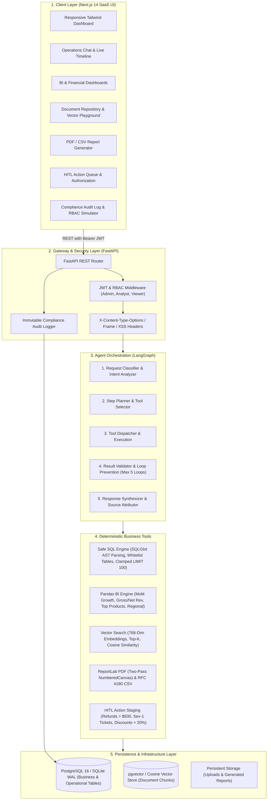

# Architecture Documentation: Enterprise AI Business Operations Agent

## 1. System Overview
The **Enterprise AI Business Operations Agent** is a production-grade, portfolio-quality Agentic AI platform built for enterprise operational intelligence, automated business analysis, policy-grounded knowledge discovery, and governed action execution.

The platform is designed around strict separation of concerns across seven foundational architectural layers:
1. **Client Layer:** Next.js 14 App Router, React 18, TypeScript, and Tailwind CSS.
2. **API & Security Gateway:** FastAPI with PyJWT authentication, bcrypt password hashing, role-based access control (RBAC), security headers, and rate limiting.
3. **Agent Orchestration Layer:** LangGraph cyclical state machine with intent classification, tool planning, loop prevention, and 5-iteration ceiling.
4. **Data Analytics & Text-to-SQL Engine:** SQLGlot AST-verified safe read-only SQL engine and deterministic Pandas BI engine.
5. **Document Ingestion & Vector RAG:** Multi-format parser (PDF, DOCX, TXT), 768-dimensional embeddings, and vector similarity retrieval with grounded citations.
6. **Reporting & Governance Layer:** Publication-grade ReportLab PDF generator with two-pass `NumberedCanvas`, RFC 4180 CSV exports, and Human-in-the-Loop (HITL) approval gates.
7. **Infrastructure & Persistence Layer:** Dual-storage architecture (SQLite WAL for zero-config local development and PostgreSQL 16 + pgvector for production), containerized via Docker and Docker Compose.

---

## 2. High-Level Architecture Diagram

---

## 3. The 7 Architectural Layers

### Layer 1: Client Application (Next.js 14 App Router)
- **Framework:** Next.js 14 with TypeScript, Tailwind CSS, and Lucide React icons.
- **Routing:** App Router architecture supporting 8 dedicated operational modules:
  - `/` (Executive Dashboard with system health and financial KPI ribbons)
  - `/chat` (Agent Operations Chat with step-by-step LangGraph timelines, markdown tables, visual cards)
  - `/analytics` (Financial analytics, MoM trends, product rankings, and regional market distribution)
  - `/knowledge` (Multi-format document upload zone, chunk inspector, and vector search playground)
  - `/reports` (Executive summary, detailed sales, and regional breakdown generator with instant downloads)
  - `/approvals` (Human-in-the-loop pending action queue with payload inspection and decision forms)
  - `/audit` (Security audit event ledger with action filters and structured JSON detail drawer)
  - `/settings` (Infrastructure inspector and interactive RBAC Role Simulator)
- **Security:** Sanitized client rendering, zero exposure of API keys, internal prompts, or chain-of-thought tokens.

### Layer 2: API Gateway & Enterprise Security
- **Authentication:** Stateless JSON Web Tokens (HMAC-SHA256) via `PyJWT` with configurable expiration.
- **Password Security:** Salted password hashing using `bcrypt`.
- **Role-Based Access Control (RBAC):**
  - `admin`: Unrestricted system access, user management, approval reviews, audit trail inspection.
  - `analyst`: Safe SQL queries, Pandas analytics, RAG search, report generation, audit trail inspection.
  - `viewer`: Read-only queries, executive dashboard, and report downloads.
- **Audit Logging:** Every sensitive event (login, failed login, upload, report creation, approval decision) is recorded into `audit_logs` with user identity, client IP, endpoint, HTTP status, and JSON metadata.
- **Security Headers:** Enforces `nosniff`, `X-Frame-Options: DENY`, `X-XSS-Protection`, and execution time tracking via `X-Process-Time-Sec`.

### Layer 3: LangGraph Agentic Orchestrator
- **State Machine Structure:** Cyclical directed graph built with `langgraph.graph.StateGraph`.
- **Pipeline Nodes:**
  1. `classify_request`: Analyzes natural language input and categorizes intent (`SQL_QUERY`, `BI_ANALYTICS`, `KNOWLEDGE_SEARCH`, `REPORT_GENERATION`, `ACTION_APPROVAL`, `GENERAL_QUERY`).
  2. `plan_steps`: Formulates structured execution plan and identifies optimal enterprise tool.
  3. `execute_tools`: Dispatches tool call with validated parameters.
  4. `validate_results`: Evaluates output completeness and guards against infinite retry loops.
  5. `synthesize_response`: Produces grounded, enterprise-formatted response with source citations.
- **Guardrails:**
  - Hard ceiling of **5 iterations maximum**.
  - Cycle detection preventing tool re-execution on identical arguments.
  - Thread-safe database context passing using Python `ContextVar`.
  - Transparent Mock Mode (`[SIMULATED RESPONSE - MOCK MODE]`) when `GEMINI_API_KEY` is not configured.

### Layer 4: Data Engine & Safe Text-to-SQL
- **AST Parsing:** Tokenizes SQL queries using **SQLGlot 30.26** before execution.
- **Whitelist Schema:** Strictly restricts queries to operational business tables:
  `customers`, `products`, `orders`, `order_items`, `sales_records`.
- **Blocked Operations:** Automatically rejects `INSERT`, `UPDATE`, `DELETE`, `DROP`, `ALTER`, `CREATE`, `TRUNCATE`, `EXEC`.
- **Shielded Tables:** Prevents access to `users`, `audit_logs`, `chat_sessions`, `chat_messages`, and system catalogs (`sqlite_master`, `information_schema`).
- **Execution Constraints:** Automatic `LIMIT 100` clamping and 5.0-second execution timeout.
- **Pandas BI Engine:** Deterministic calculation of Gross/Net Revenue, MoM growth % (with division-by-zero protection), top-selling products, regional sales distributions, and customer cohorts.

### Layer 5: Vector RAG & Document Knowledge Base
- **Multi-Format Ingestion:** Ingests PDF (`pypdf`), DOCX (`python-docx`), and TXT files up to 15MB.
- **Header & Path Validation:** Validates magic headers (`%PDF-`, `PK\x03\x04`), sanitizes filenames, and prevents directory traversal attacks.
- **Duplicate Prevention:** SHA-256 content hashing returns HTTP 409 Conflict if an identical document is uploaded.
- **Scanned PDF Handling:** Detects zero extractable text in PDFs and alerts that OCR is required rather than falsely reporting indexing.
- **Embeddings:** Official Google GenAI SDK `text-embedding-004` (768 dimensions), backed by a deterministic SimHash signed random projection mock for zero-network testing.
- **Dual Vector Store:** In-memory cosine similarity search for SQLite development and native vector storage for PostgreSQL.

### Layer 6: Downloadable Reports & HITL Governance
- **Publication-Grade PDF Generation:** Built with ReportLab using a custom two-pass `NumberedCanvas` that dynamically computes total page count ("Page X of Y"), running header rules, and confidentiality notices.
- **RFC 4180 CSV Export:** Comma-separated values generator with sanitized headers and proper quoting.
- **Report Catalog:** `executive_summary`, `sales_detailed`, and `regional_breakdown`.
- **Human-in-the-Loop (HITL) Gate:**
  - High-impact operational actions trigger automatic interception:
    - Customer refunds exceeding $500.
    - Severity-1 technical incident tickets.
    - Contract discount overrides exceeding 20%.
  - Actions are staged as `PENDING` records in `approval_requests` with corporate policy citations.
  - Authorized operators review, approve, or reject via `/approvals` with reviewer attribution and audit logging.

### Layer 7: Containerization & Deployment Orchestration
- **Backend Dockerfile:** Multi-stage Python 3.12-slim build with non-root `appuser`, cached dependency installation, and integrated healthcheck.
- **Frontend Dockerfile:** Multi-stage Node 20-alpine build with `deps`, `builder`, and `runner` stages, unprivileged `nextjs` user, and integrated healthcheck.
- **Docker Compose:** Complete 3-tier orchestration:
  - `postgres`: PostgreSQL 16 with pgvector extension (`pgvector/pgvector:pg16`), healthcheck, and persistent volume `enterprise_ai_pgdata`.
  - `backend`: FastAPI service waiting for healthy database, mounting persistent volumes for uploads and reports.
  - `frontend`: Next.js 14 dashboard waiting for healthy backend.

---

## 4. API Endpoints Matrix

| Method | Endpoint | Description | Role Required |
|:-------|:---------|:------------|:--------------|
| `GET` | `/api/health` | Service health status and uptime | Public |
| `GET` | `/api/health/db` | Database connection verification | Public |
| `POST` | `/api/auth/login` | User login, returns JWT access token | Public |
| `GET` | `/api/auth/me` | Current authenticated user profile | Viewer |
| `GET` | `/api/auth/users` | List registered platform users | Admin |
| `POST` | `/api/chat` | Send prompt to LangGraph agent | Viewer |
| `GET` | `/api/chat/history` | Retrieve message history for a session | Viewer |
| `GET` | `/api/chat/sessions` | List active user chat sessions | Viewer |
| `DELETE`| `/api/chat/sessions/{id}`| Delete chat session and messages | Viewer |
| `GET` | `/api/analytics/summary` | Enterprise financial KPI summary | Viewer |
| `GET` | `/api/analytics/growth` | Month-over-month revenue growth | Viewer |
| `GET` | `/api/analytics/top-products`| Top products by revenue and volume | Viewer |
| `GET` | `/api/analytics/regional`| Regional sales and market share | Viewer |
| `GET` | `/api/analytics/customers`| Customer spending tiers analysis | Viewer |
| `POST` | `/api/documents/upload` | Upload and index PDF, DOCX, or TXT | Admin |
| `GET` | `/api/documents` | List indexed documents and metadata | Viewer |
| `GET` | `/api/documents/{id}` | Inspect document details and chunks | Viewer |
| `GET` | `/api/documents/{id}/status`| Check document indexing progress | Viewer |
| `POST` | `/api/documents/search` | Semantic vector similarity search | Analyst |
| `DELETE`| `/api/documents/{id}` | Delete document and vector chunks | Admin |
| `POST` | `/api/reports/generate` | Generate publication PDF or CSV | Analyst |
| `GET` | `/api/reports` | List generated reports archive | Viewer |
| `GET` | `/api/reports/download/{id}`| Download report file (attachment) | Viewer |
| `DELETE`| `/api/reports/{id}` | Delete report file and record | Admin |
| `GET` | `/api/approvals` | List staged approval requests | Viewer |
| `GET` | `/api/approvals/{id}` | Inspect staged request payload | Viewer |
| `POST` | `/api/approvals/{id}/review` | Approve or reject staged action | Admin |
| `GET` | `/api/audit` | Paginated compliance audit logs | Analyst |
| `GET` | `/api/audit/stats` | Audit summary statistics | Analyst |

---

## 5. Security & Verification Guarantees

| Security Requirement | Implementation | Verification Method |
|:---------------------|:---------------|:--------------------|
| **SQL Injection Prevention** | SQLGlot AST validation, whitelist tables only, rejected DDL/DML | 12 dedicated pytest security tests |
| **Data Mutating Query Defense** | Automatic rejection of `INSERT`, `UPDATE`, `DELETE`, `DROP` | Automated test suite verification |
| **Prompt Injection Defense** | Sanitized system prompts, untrusted chunk context demarcation | Verified in LangGraph orchestrator |
| **Malicious File Uploads** | Magic byte inspection (`%PDF-`, `PK\x03\x04`), 15MB size limit | Document processing test suite |
| **Path Traversal Defense** | Filename sanitization via `os.path.basename` | Path traversal pytest assertions |
| **Agent Infinite Loops** | Hard ceiling of 5 iterations with cycle tracking | State machine unit tests |
| **Password Storage** | Salted hashing via `bcrypt` | Auth security tests |
| **Tamper-Evident Auditing** | Read-only compliance audit ledger for all sensitive actions | Audit endpoint test suite |
