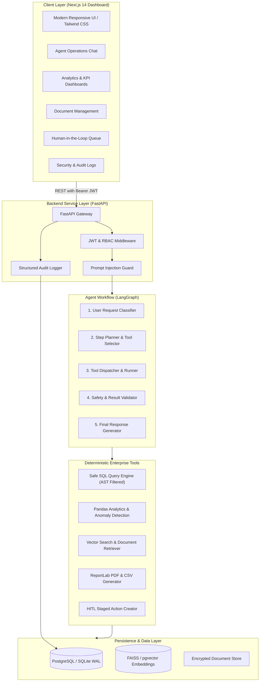

# Architecture Documentation: Enterprise AI Business Operations Agent

## 1. System Overview
The **Enterprise AI Business Operations Agent** is an enterprise-grade agentic platform built to automate operational decision support, financial reporting, business analytics, and internal knowledge discovery.

It decouples agent reasoning, deterministic tool execution, and data persistence to guarantee auditability, security, and reproducibility.

---

## 2. High-Level Architecture Diagram

---

## 3. LangGraph Workflow State Machine

The agent operates as a cyclical graph with deterministic termination criteria:

### Graph State Schema (`AgentState`)
- `messages`: List of conversation messages (System, Human, AI, Tool).
- `intent`: Classified query category (`SQL_QUERY`, `BI_ANALYTICS`, `KNOWLEDGE_SEARCH`, `REPORT_GENERATION`, `ACTION_APPROVAL`, `GENERAL_QUERY`).
- `plan`: Structured execution steps generated by the planner.
- `tool_calls`: Queue of selected tool calls with validated arguments.
- `tool_results`: Dictionary of executed tool outcomes.
- `iteration_count`: Integer counter incremented at each loop (Hard ceiling: 5 iterations).
- `requires_approval`: Boolean flag if high-risk action was proposed.
- `staged_action_id`: UUID of pending HITL action.
- `error`: Optional error string triggering recovery or user explanation.

### Execution Cycle:
1. **Classify Request:** Analyzes intent and determines domain requirements.
2. **Plan & Select Tools:** Evaluates whether external database, document knowledge base, or analytics are required.
3. **Execute Tools:** Invokes tools within a sandboxed context with query timeouts.
4. **Validate Results:** Inspects tool output. If empty or invalid, permits one targeted refinement or formats graceful fallback.
5. **Synthesize Final Response:** Generates professional, cited response adhering to enterprise constraints (no hallucinated facts, source attribution).

---

## 4. Security & Guardrails

### 4.1 Safe Text-to-SQL Architecture
- **AST Parsing:** Queries are tokenized and parsed via `sqlglot`.
- **Whitelisted Statement Types:** ONLY `SELECT` statements are allowed.
- **Forbidden Keywords:** Rejects `INSERT`, `UPDATE`, `DELETE`, `DROP`, `ALTER`, `CREATE`, `TRUNCATE`, `EXEC`, `UNION ALL SELECT ...` system tables.
- **Statement Limiting:** Multiple queries separated by semicolons are strictly rejected.
- **Row Clamping:** Automatic `LIMIT 100` appended if not provided.
- **Execution Timeout:** Enforced 5.0 second query timeout to prevent denial-of-service.

### 4.2 RAG Grounding & Prompt Injection Defense
- User prompts pass through regex-based and semantic injection filters (detecting prompt leaks, roleplay jailbreaks, system instructions override).
- Document chunks retrieved via vector similarity are treated as untrusted text within the synthesis context.
- System prompt instructs LLM: *"Base answers solely on the verified document excerpts provided. If the retrieved text does not contain the answer, explicitly state that the knowledge base lacks sufficient data."*

### 4.3 Human-in-the-Loop (HITL) Gate
- Any state-altering action (e.g., creating an IT support ticket, initiating a customer dispute review) is staged into an `ApprovalRequest` record with status `PENDING`.
- Execution is halted until an authenticated user with appropriate permissions clicks "Approve" in the dashboard.

---

## 5. Relational Data Models

- **`users`**: `id`, `username`, `email`, `hashed_password`, `role` (`ADMIN`, `ANALYST`, `VIEWER`), `is_active`, `created_at`
- **`customers`**: `id`, `name`, `email`, `company`, `region`, `tier` (`Enterprise`, `Mid-Market`, `SMB`), `status`, `created_at`
- **`products`**: `id`, `sku`, `name`, `category`, `unit_price`, `cost_price`, `stock_quantity`, `is_active`
- **`orders`**: `id`, `order_number`, `customer_id`, `order_date`, `status` (`Completed`, `Pending`, `Cancelled`, `Refunded`), `total_amount`, `payment_method`
- **`order_items`**: `id`, `order_id`, `product_id`, `quantity`, `unit_price`, `discount_percent`, `subtotal`
- **`sales_records`**: `id`, `date`, `region`, `channel`, `gross_revenue`, `net_revenue`, `order_count`, `customer_count`
- **`documents`**: `id`, `filename`, `file_type`, `file_size`, `content_hash`, `chunk_count`, `uploaded_by`, `created_at`
- **`document_chunks`**: `id`, `document_id`, `chunk_index`, `content`, `token_count`, `embedding_vector`
- **`approval_requests`**: `id`, `action_type`, `description`, `payload_json`, `status` (`PENDING`, `APPROVED`, `REJECTED`), `requested_by`, `reviewed_by`, `created_at`, `resolved_at`
- **`audit_logs`**: `id`, `user_id`, `ip_address`, `endpoint`, `action`, `resource_type`, `resource_id`, `status_code`, `timestamp`, `details_json`

